# Chocofi ZMK config + beginner's guide

You bought a **Chocofi** (36-key split keyboard, nice!nano v2 controllers, nice!view displays). It runs
[ZMK](https://zmk.dev) firmware. This guide assumes you have never used ZMK.

## 1. The big picture

A ZMK keyboard has no settings app. The keymap is a **text file**; GitHub builds it into firmware
(`.uf2` files) for you, and you copy those files to the two halves over USB.

```
edit config/base.keymap on GitHub  ->  GitHub Actions builds  ->  download .uf2  ->  copy to each half
```

You need: a free GitHub account, a USB cable, and a browser. No programming tools on your computer.

## 2. First steps (do these in order)

1. **Fork this repo** (button *Fork*, top right). Everything below happens in *your* fork.
2. Open your fork -> **Actions** tab -> enable workflows if GitHub asks.
3. The *Build* workflow runs automatically. Wait ~3-5 min until it is green, open the run and
   download the artifact **firmware** (a zip). Inside: `chocofi_left ... .uf2`, `chocofi_right ... .uf2`,
   and `settings_reset ... .uf2`.
4. **Reset the keyboard to a clean state** (it still remembers the previous owner's Bluetooth pairings):
   - Plug the **left** half in by USB and **double-tap the reset button** (on the nice!nano, next to the USB port).
     A drive named `NICENANO` appears.
   - Copy `settings_reset ... .uf2` onto it. The drive disappears by itself. Do the same for the **right** half.
5. **Flash the real firmware:** repeat with `chocofi_left ... .uf2` on the left half and `chocofi_right ... .uf2`
   on the right half. Order does not matter, but **flash settings_reset on both halves first**, then the real firmware on both.
6. Switch both halves on (power switch on the nice!nano). The halves find each other automatically.
   Now pair with your computer (section 5).

If a half does not show up as a drive: use a data USB cable (not charge-only) and double-tap reset faster.

## 3. Changing the keymap (no installs)

The easy way: open your fork on GitHub and press the **`.` key**. This opens a web editor (github.dev).
Open `config/base.keymap`, edit, and *commit* (Source Control icon). A new build starts; download the new `.uf2`
files and flash them as in step 5. Only the half you changed needs reflashing if the change is in one half's keys,
but flashing both is always safe.

**Always look at the picture first:** `keymap_drawer/dummy.svg` (also at the bottom of this page) draws every layer.
After each commit it is regenerated by the *Draw* workflow, so you can see your change as a picture.

### Reading the keymap

Each layer is a block like this, **36 keys in this order**: left half rows 1-3 (5 keys each), right half rows
1-3, then the thumbs (left 3, right 3):

```
default_layer {
    bindings = <
        &kp Q  &kp W  ...        &kp P     <- top row (left 5, right 5)
        ...
    >;
};
```

Common bindings:

| You write | Meaning |
|---|---|
| `&kp A` | press A. `&kp LS(A)` = Shift+A. `&kp LC(C)` = Ctrl+C |
| `&mo NAV` | hold = momentarily switch to layer NAV |
| `&lt NAV SPACE` | tap = Space, hold = layer NAV |
| `&mt LSHIFT A` | tap = A, hold = Shift |
| `&hml LSHIFT A` / `&hmr ...` | **home-row mod** (this config's timing-aware version, left/right hand) |
| `&to BASE` | switch permanently to a layer |
| `&bt BT_SEL 1` | select Bluetooth profile 1 |
| `&trans` (`___`) | transparent: use the key from the layer below |
| `&none` (`xxx`) | nothing |

Key names: [zmk.dev/docs/keymaps/list-of-keycodes](https://zmk.dev/docs/keymaps/list-of-keycodes).
Rules to remember: **layers are numbered** (`#define` list at the top of `base.keymap`) and the blocks inside
`keymap { }` must stay in that same order; every layer needs exactly 36 entries.

### How this layout is organised (the previous owner's design)

- **Home-row mods:** the middle row letters are also Shift/Ctrl/Alt/GUI when *held* (only if you then press a key
  with the other hand). If it misfires, the timings are `TAP_TERM_MS`, `QUICK_TAP_MS` and `require-prior-idle-ms`
  near the top of `base.keymap`.
- **Layers:** BASE (PC) · BASE_MAC · UA / UA_MAC (Ukrainian overlay) · NUM · NAV (arrows, hold left Space) ·
  SYM_L / SYM_R (symbols) · CMD_NUM · ADJ (hold NAV + SYM_L: Bluetooth, media, reset) · LOCK.
- **Combos:** pressing two keys at once types a symbol/shortcut (brackets, copy/paste, ...). They live in
  `config/combos.dtsi`.
- **PC vs Mac:** Windows/Linux is default. Choose macOS with the Mac key on the ADJ layer.
- **Ukrainian:** a language overlay (right Space + right Ctrl). If you do not need it, ignore it, or delete the
  UA layers carefully (renumber the `#define`s and the layer blocks in the same order, and remove their combos).

Tip for a first edit: change one letter on the BASE layer, commit, flash, confirm it works. Small steps; if
something breaks, open *History* of the file on GitHub and restore the previous version.

## 4. Visual editors (and their limits)

- **Keymap Editor** (https://nickcoutsos.github.io/keymap-editor) edits the keymap of a GitHub repo in a visual
  drag-and-drop view and commits for you. Worth a try on your fork (log in with GitHub, pick the repo).
  Caveat: this config is advanced (custom macros, hold-taps and `#define` shortcuts). The editor may not parse
  everything, so **test on a branch**, not on `main`, and check the result with the Draw workflow.
- **ZMK Studio** (live editing over USB with no flashing) is **not enabled** in this build. This config also
  uses a modified ZMK (Urob's), and combos/macros are not editable in Studio anyway. If you want it, start from
  the official ZMK docs: https://zmk.dev/docs/features/studio.
- Honest recommendation: use the GitHub web editor + the picture. It is fast enough once you know the table above.

## 5. Bluetooth pairing

Hold **NAV + SYM_L** together (opens layer ADJ). On the left half, top row:

| Key | Does |
|---|---|
| `BT_CLR` (first key) | forget the pairing of the *current* profile |
| next keys | profile 2 (Mac) / 1 (Windows) / 0 (KDE) + switch matching base layer |
| second row | two more profiles (3, 4) |

To pair a new computer: pick a profile -> press `BT_CLR` -> find the keyboard in the computer's Bluetooth list.
Pair the first device with the **left** half. To save battery or to use USB instead, the output toggle key
on the second row switches between USB and Bluetooth.

## 6. Troubleshooting

| Problem | Fix |
|---|---|
| Right half types nothing | Reflash `settings_reset` on **both** halves, then the real firmware on both, switch both on |
| Computer shows keyboard but does not connect | On the computer remove the keyboard from Bluetooth, `BT_CLR` on the keyboard, pair again |
| A key does nothing / wrong character | Check the host layout: PC symbols assume *US International (AltGr dead keys)* |
| Build is red (Actions) | Open the run, read the red step. Usually a typo, wrong number of keys in a layer, or layer order |
| Keyboard stuck / weird | Double-tap reset on that half and reflash |
| Battery drains | Turn the power switch off when not used. Deep sleep starts after 15 min idle |

## 7. Useful links

- ZMK docs: https://zmk.dev/docs
- Key codes: https://zmk.dev/docs/keymaps/list-of-keycodes
- Behaviors (hold-tap, combos, macros): https://zmk.dev/docs/keymaps/behaviors
- This config is based on [urob/zmk-config](https://github.com/urob/zmk-config) (read its README to understand
  home-row mods and the extra behaviors).
- ZMK Discord (very helpful): linked from zmk.dev

---

## About this layout

> **Note**
> The drawing at the end of this page is automatically updated at each commit
> via a Github actions workflow. You can refer to that to get a sense of the
> keymap I'm currently using. Some glyphs may not make sense to you, please
> refer to the keymap file and drawing config file in such case.

This is a [ZMK](https://zmk.dev) config repo for my 34/36-keys Chocofi keyboard,
arranged in 3 rows and 5 columns with 3 thumb keys on each side, using
the Canary layout.

The configuration is heavily inspired (although simplyfied) by [Urob](https://github.com/urob/zmk-config)'s keymap.

Some highlights:

- Urob's [timeless
  HRMs](https://github.com/urob/zmk-config#timeless-homerow-mods) configuration
 is used. `CTRL` and `GUI` are swapped in the OSX base layer to favor muscle
 memory across different operating systems
- The `BASE` and `NAV` layers are duplicated to work with both Windows and
  MacOS (the macros on the ADJ layer both change the bluetooth profile and the
  toggle the correct base layer)
- The most commonly used shortcuts (e.g., copy and paste) are implemented as combos on
  the right hand side of the base layers to ease one-handed use while using the
  mouse
- Parenthesis are combos on the `BASE` layer. The other symbols are vertical
  combos on the same layer (logically linked symbols are on the same column,
  e.g. `+` and `-` or `&` and `|`)
- Combos are also defined to open and close parenthesis and put the cursor in
  between them
- The combo on the left pinky and middle finger home row keys is a dead key
  modifier, to be used to easily
produce Italian accented letters using the `US-Intl with AltGr Dead Keys`
- Symbols on the `BASE` layer are mod-morphed with shift to produce more
  intuitive results.
- Over-powered thumb keys:
  - `Shift + Space` outputs `. + Space` and activates Shift for the next
    keytap. Quick roll on the two inner thumb keys to quickly end a sentence and
    start a new one
  - Double-tapping `Sticky Shift` enables `Caps Word`.
  - `Backspace` morphs into `Delete`
- The layout basically relies on 34 keys only (one could easily get rid of the
  outer thumb keys) and could also be reduced to 30 keys (the upper keys on the
  outer columns and the bottom ones on the inner columns are only used on the
  base layers)

## Reference layout



(Visualization generated with [@caksoylar/keymap](https://github.com/caksoylar/keymap-drawer))
